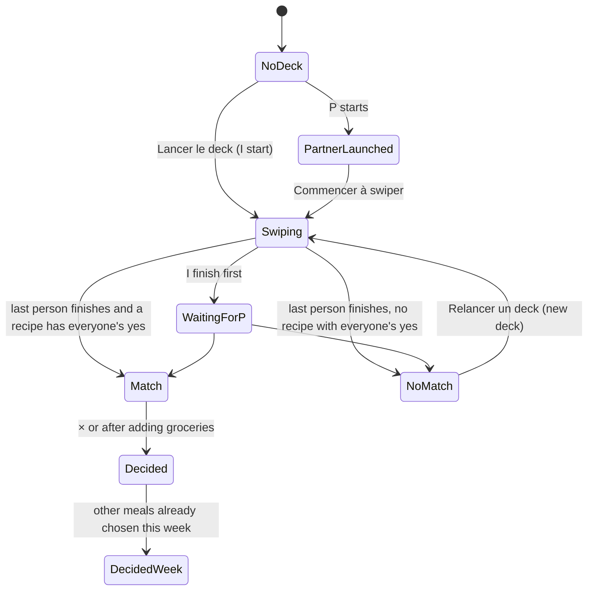

# Household app: design handoff

Prepared 6 November 2026 for Claude Code. The app is already built; this pack covers the redesign of the core screens, recipe creation and the groceries tab, plus the design system they share.

**Read in this order:** this file, then `design-system/README.md`, then `screens/screens.json` with the PNGs open beside you.

## 1. What is in the pack

| Path | What | Use it for |
| --- | --- | --- |
| `HANDOFF.md` | This document: scope, flows, intents, data rules | The source of truth for behaviour |
| `design-system/README.md` | Brand book: principles, colour = meaning, type, layout, copy, icons | Styling decisions |
| `design-system/tokens.json` | All tokens with a usage note each (light + dark) | Generating theme code |
| `design-system/tokens.css` | Same tokens as CSS variables, light/dark, plus `.t-*` type classes | Drop-in for a web/PWA build |
| `design-system/tailwind.preset.js` | Tailwind preset mapping to those variables | If the app uses Tailwind |
| `design-system/components/<Name>/` | README (rules) + `preview.html` (live, uses tokens.css) | Building or restyling components |
| `design-system/previews/*.png` | Renders of each component | Visual reference |
| `screens/screens.json` | Manifest: id, flow, state, size, links, notes, canvas board name | Navigating the screens programmatically |
| `screens/html/*.html` | Each screen as a standalone HTML mock-up (390pt wide), links between screens work | Exact spacing, sizes and copy |
| `screens/png/*.png` | Each screen rendered at @2x | Visual reference, pixel comparison |
| `index.html` | Gallery of every screen grouped by flow | Browsing |

The HTML mock-ups are **reference, not production code**: they use inline styles and literal colours. Rebuild them with the app's own components and the tokens. Where a mock-up and `tokens.json` disagree on a colour, **the tokens win** (two values were darkened for contrast: buttons about P use `iris-strong`, the indispensable tag uses `star-text`).

## 2. Scope

| Area | Status in this pack |
| --- | --- |
| Ce soir (home) and its states | Redesigned: 7 screens |
| Swipe, expanded card, match, no match | Redesigned: 4 screens + 2 sheets |
| Recipe page | Redesigned: one vertical scroll |
| Recipe creation (link, photo, manual) | Redesigned: 8 screens |
| Recipes library | v2 style, not reviewed since; restyle with the DS |
| Nous, allergies, household settings, regular programme | Redesigned: 4 screens |
| Courses (groceries tab) | Behaviour final; visuals are the earlier style with **English copy**: translate to French and restyle with DS v2 |
| This week | **No change: keep the screen currently in the app** |

## 3. Flows

### Ce soir: one deck per evening

| State | Screen | Notes |
| --- | --- | --- |
| No deck | `ce-soir-no-deck` | Week strip, big terracotta "Lancer le deck" card, one summary row for settings |
| Deck settings | `ce-soir-deck-settings`, `ce-soir-envies` | Bottom sheets |
| P launched, I have not swiped | `ce-soir-partner-launched` | Only "Commencer à swiper" |
| I finished, P has not started | `ce-soir-waiting` | The most common waiting state. "Relancer P" nudges her |
| P is mid-deck | (variant of waiting) | Same card with her progress bar filled (see canvas v4 `rn3-TonightWaiting`) |
| Decided, nothing else planned | `ce-soir-decided` | Focus on tonight: cook, then groceries |
| Decided + other planned meals | `ce-soir-decided-week` | Tonight first, "À venir", one groceries card for all |

### Swipe → match → groceries

`swipe` → tap card → `swipe-expanded` → like/pass… → `match` → "Ajouter les ingrédients aux courses" → `groceries-what-you-have` (or `-multi` from Ce soir) → Courses tab.

### Recipe creation

Recettes "+" → `recipe-new-start` → (paste link → `recipe-import-result`) or (write it → `recipe-new-empty` → time / details sheets → `recipe-new-filled`) → `recipe-new-saved`.

### Nous

`nous` → household row → `nous-settings`; allergies card → `nous-allergies`; settings or This week → `regular-programme`.

## 4. Non-obvious intents

These came out of review rounds and are easy to get wrong. They matter more than pixel accuracy.

### Product rules

1. **One deck per household per evening.** While a deck is running nobody can start another. A new deck is only possible after a no-match.
2. **No veto, no tie-break.** If no recipe gets everyone's yes, show "Pas de match" and offer a new deck. The next deck should learn from what each person liked.
3. **Matching**: a recipe matches when every eater said yes (indispensable counts as a yes and boosts ranking). First match wins.
4. **Deck defaults are silent.** Nous deux · Moins d'1 h · the user's favourite category (from their swipe history), falling back to "Tout". Never label them as "based on your habits".
5. **Deck settings are secondary.** They live in a sheet behind a one-line summary; the home screen is about dealing the deck.
6. **Swiping for future days exists** (a planned evening can be decided ahead). That is why Ce soir has a "decided + upcoming meals" state and the groceries card covers every planned meal, not only tonight.
7. **After a match at 2 pm the user must be able to leave.** The match screen has a × that lands on the decided home. Nothing forces cooking now.
8. **We can never know what is at home.** So the main action after a match is "Ajouter les ingrédients aux courses", which opens "Qu'avez-vous déjà ?" with probably-owned items pre-ticked; everything left unticked goes to the list. "Probably at home" comes from recent purchases and the staples list.
9. **Reminders are not on the home screen.** The cooking reminder and the evening question live in Nous → household settings → Notifications.
10. **Allergies belong to a person but filter the whole household's decks** (one pot, two plates). The user picks common allergens or adds catalog ingredients. Catalog ingredients are linked (fruits à coque → noix, noisettes, amandes…, and preparations such as pesto or praliné), and an allergy excludes every linked ingredient. **Never explain this mechanism in the UI.**
11. **Recipe tags are inferred** from ingredients, time and type (Végétarien, Pâtes, Rapide, Italien), shown pre-selected and removable. Units on ingredients and groceries are inferred from the catalog too.
12. **Recipe time is one value by default.** Splitting prep and cooking is an option for slow or oven dishes.
13. **This week stays as it is in the app.** The new "Programme régulier" screen sets the default evenings eaten together.

### Interaction details

- The swipe card expands **by tapping the card**; there is no "Détails" button. The expanded view keeps the action row.
- Swipe actions, left to right: **undo last choice**, pass, like, indispensable.
- The expanded card and recipe page show difficulty and **cookware** ("1 sauteuse · 1 casserole · pas de four").
- The recipe page is **one vertical scroll**, ingredients then steps, all visible. No tabs, no "+ 6 autres".
- On the match screen there is **no per-person portion split**; protein is shown.
- Nous reaches household settings through a **visible household row** at the top, not a gear icon.
- Insights ("On a remarqué") are phrased as a **question with two answers** ("Oui, le lundi" / "Non merci").
- Groceries: tapping + adds immediately and turns into a quantity/unit/trash module; the module never shrinks and long names wrap. The "Create" row is visually distinct because it edits the catalog and opens a sheet for aisle and unit. Catalog items have **no images**. The usuals entry is an **icon only**.
- Groceries while shopping: checked items move to an **"In the cart" section** with who checked them, a progress count, uncheck, and **Clear** with undo. This was explicitly called out as important. The grouping switch stays visible while shopping. Rows show right-aligned quantities and no recipe tags.
- Usuals: frequency and last-bought only in "Due again"; elsewhere just the category. No "Already on your list" section.

### Visual and copy rules (from review)

- **One primary terracotta button per screen.** A tinted card's action lives inside the card in the card's colour (green "Ajouter" on the Courses card).
- **Selected chips are terracotta-soft with a terracotta ring, not black.**
- **Colour = meaning**: terracotta = tonight and actions; sage = groceries / at home / done; iris = P; yellow only for the indispensable star; reminders = light-red dashed block. No rainbow icon tiles: icon tiles take their section's colour.
- **Cut explanatory copy.** Rejected examples: "Un seul deck à la fois…", "puisque vous mangez la même chose", "« Fruits à coque » exclut aussi…", "Préréglé d'après vos mardis", "Instagram · 6 / 12", AI reasons on the swipe card. Empty days are empty, not "Pas ensemble".
- **Avoid "Christmas tree" screens**: few kinds of UI per screen, one control per row.
- A home screen should not be all grey; at least one block carries colour.
- Copy is French, "vous". "P" in the mock-ups is a placeholder for the partner's first name.

## 5. Data and logic needed

| Need | Suggested source |
| --- | --- |
| Deck lifecycle per household per date: none / open / each member's progress / matched / no match | `decks` with status and `deck_members(progress, finished_at)`; enforce one open deck per household per date |
| Planned meals per date (tonight and future) | `meals(household_id, date, recipe_id, decided_at)` |
| Default deck settings | Favourite category = most-liked category over recent swipes; fallback "Tout" |
| "Probably at home" | Recent purchases (cleared cart items) + household staples list |
| Allergies | `member_allergies(member_id, allergen_group_id or ingredient_id)`; deck filter is the union across eaters |
| Linked ingredients | Catalog links: `ingredient_links(parent_id, child_id)` or allergen groups; preparations link to their components |
| Inferred recipe tags | Rules from ingredients (no meat/fish → Végétarien), time (≤ 30 min → Rapide), dish type; stored as editable tags |
| Cookware | Recipe fields: pans count, oven yes/no, special equipment |
| Regular programme | `household_routine(weekday, eats_together)` seeding each week |
| Notifications | Evening question time (default 17:30), cooking reminder on/off + time (default 19:00), partner-checks-items on/off |

## 6. Screen inventory

See `screens/screens.json` for links and canvas names; PNGs in `screens/png/`.

| Flow | Screens |
| --- | --- |
| Ce soir | ce-soir-no-deck, ce-soir-deck-settings, ce-soir-envies, ce-soir-partner-launched, ce-soir-waiting, ce-soir-decided, ce-soir-decided-week |
| Swipe | swipe, swipe-expanded, match, no-match, groceries-what-you-have, groceries-what-you-have-multi |
| Recettes | recipe, recipes-library |
| Recipe creation | recipe-new-start, recipe-import-result, recipe-new-empty, recipe-new-time, recipe-new-time-split, recipe-new-details, recipe-new-filled, recipe-new-saved |
| Nous | nous, nous-allergies, nous-settings, regular-programme |
| Courses | groceries-list-aisle, groceries-list-recipe, groceries-list-az, groceries-shopping, groceries-empty, groceries-search-idle, groceries-search-results, groceries-search-none, groceries-create-item, groceries-qty, groceries-unit, groceries-usuals-due, groceries-usuals-all |
| Reference | palette |

## 7. Open questions

- **Deciding a future day:** the entry point (from This week in the existing app?) and whether a future deck follows the same one-deck rule per date.
- **"Juste moi" decks:** does a solo deck decide the evening for the household, or only for that person?
- **Category list:** the definitive list of "Envies" categories and which ones the recipe tag inference can produce.
- **Photo-recipe scan:** the "Photographier une recette" option has no screen yet (needs OCR); it currently falls back to the manual form.
- **Partner notifications:** copy and timing for "P a lancé le deck" and the nudge.
