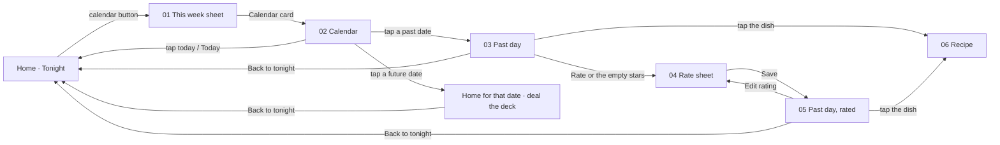

# Calendar & rating: design handoff

Prepared 26 November 2026 for Claude Code. These are the screens from the canvas page **"Calendar and Rating"**. The app is in English, uses the Household Warm v2 design system, and is a PWA. The mock-ups are reference, not production code. Reuse the app's existing components and tokens wherever they already exist.

**What this adds**
- Go back to any past date to see what you ate, and rate it.
- Go forward to any future date to decide dinner ahead.
- Mark a dish as a favourite.

**Read in this order:** this file, then `screens/screens.json` with `screens/png/` open alongside. `screens/html/` holds each screen as a 390pt mock-up, and links between screens work. `index.html` is a gallery of all screens.

## 1. Flow

## 2. Screens

| # | Screen | What matters |
| --- | --- | --- |
| 01 | This week sheet | The existing sheet, plus a **Calendar** card ("See what you ate, or plan further ahead") below the day list, above "Regular schedule". It opens 02. |
| 02 | Calendar | A full screen with back on the left and **Today** on the right. The weekday header stays fixed, and months scroll vertically, starting on the current month. See §3 for how each day looks. Tapping a date opens the home screen for that date. |
| 03 | Past day, not rated | The home screen for that date, with the header, week strip and tab bar as normal. The card shows the dish picture, its name, who ate (avatars), time and portions. Below that are five **empty stars** with "Not rated yet". The stars and the **Rate** button both open 04. |
| 04 | Rate sheet | A dish thumbnail, the date and "How was the risotto?". Five large stars with a label (see §4), then **Add to favorites** with a round heart button: an outline heart when off, filled terracotta with a ring when on. Then **Save**. |
| 05 | Past day, rated | The household's stars, plus a "♥ Favorite" tag when the dish is a favourite. The button becomes **Edit rating**, which opens 04 prefilled. |
| 06 | Recipe | The same heart button sits in the **top-right corner** and stays in sync with the favourite set in 04. The **Edit** button is removed. The overline shows "Cooked N times · ★ rating" from the household's data. |

### Behaviour of non-today dates (03, 05 and future days)

- **Header:** the full date on top. The title is relative: "Tonight" for today, "Tomorrow", "In 8 days", "Yesterday", "9 days ago". The header has no extra buttons, so it stays uncrowded.
- **Back to tonight:** a dark pill floating above the tab bar. It returns to today and only appears when the date shown isn't today.
- **Week strip:** shows the week of the selected date, with that date filled.
- **Future dates:** use the normal home card ("What's for dinner on Friday?", deck settings, Deal the deck). The deck is saved for that date. The board on the Explorations page is "Calendar v2 · 6 · Future day".
- **Opening the recipe:** "See the recipe" was removed from the past-day card. **Tapping the dish picture** opens 06.

## 3. Calendar day states (02)

| State | Look |
| --- | --- |
| Today | Filled terracotta circle, white number |
| Past, dinner logged | Round crop of the dish illustration, with the day number under it |
| Future, deck already decided | Dish illustration with a terracotta ring |
| Future, eating at home, not decided | Dotted terracotta circle, the same convention as the week strip |
| Eating out / nothing logged | Plain grey number |
| Selected (the date you came from) | Dark ring around the day |

There is **no legend**; it was removed on purpose.

## 4. Rating rules

- **A rating belongs to the household, not to each person.** The **first person to rate a dish rates it for the household.** After that, everyone in the household sees that rating, and either person can change it with Edit rating (the last edit wins).
- **Ratings stay inside the household.** They are never written to the seed or catalogue recipe database. Don't aggregate them across households and don't use them for any global score. They can be used for this household's own deck ranking.
- **Store** one rating per (household, recipe): `stars` 1–5, `rated_by` (the member who set it), `rated_at`. Also store a household `favorite` boolean per recipe.
- **Favorite** is household-wide too. The heart in the rate sheet and the heart on the recipe screen are the same value.
- **Star labels** (suggested, shown under the stars; the mock-up shows 4 = "Really good"): 1 "Not for us", 2 "Meh", 3 "Fine", 4 "Really good", 5 "A favourite". Stars use the star-yellow token only.
- **Fix in the mock-up:** screen 04 shows "Lisa gave it 5 stars". That line comes from an earlier per-person idea and **should not be built**. When the dish is already rated, show "Rated by Lisa" with her avatar instead, and prefill the stars.
- A past day with nothing logged needs a "No dinner logged" state with a way to add what you ate. It isn't designed yet.

## 5. Recipe screen change (06)

- **Equipment line: list only the gear the recipe actually uses** (for example "1 pan · 1 saucepan"). Remove negative or unused items such as "no oven". If a recipe uses no special equipment, hide the line.
- The **Edit** button in the top bar is removed. The top bar is now back on the left and the heart on the right.

## 6. Open points

- "No dinner logged" state for past evenings (see §4).
- Whether to notify the partner when someone deals a deck for a future date.
- Notification copy for a planned future dinner (for example a reminder on the day).
