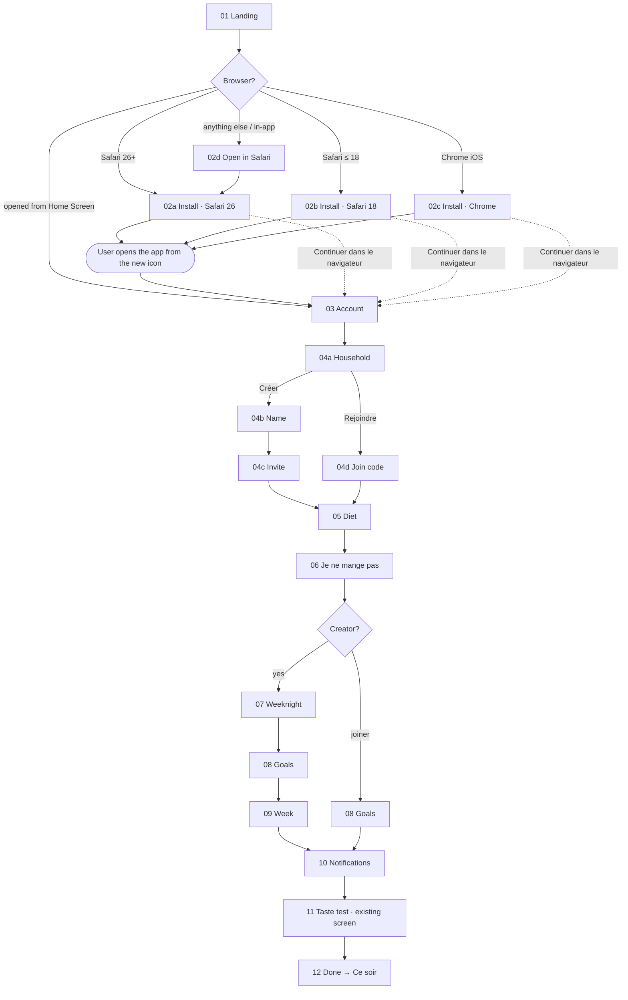

# Onboarding: design handoff

Prepared 23 November 2026 for Claude Code. This replaces the app's current onboarding. The UI is French, built with design system **Household Warm v2** (`design-system/`). The app is a PWA served from `dineamite.pages.dev`.

**Read in this order:** this file → `screens/screens.json` with `screens/png/` open → `animation/landing-loop.mp4` → `design-system/README.md`.

## 1. What is in the pack

| Path | What |
| --- | --- |
| `HANDOFF.md` | Flow, branching rules, the data each step saves, animation spec |
| `screens/screens.json` | Manifest: id, flow, canvas board, links, illustrations used, notes |
| `screens/html/*.html` | Each screen as a standalone 390pt mock-up; links between screens work; the landing animation runs |
| `screens/png/*.png` | Each screen at @2x |
| `animation/landing-loop.mp4`, `.gif` | The landing animation, one 12 s loop |
| `animation/keyframe-*.png` | Stills at 0, 1, 2, 4, 6, 8, 10 s |
| `design-system/` | Tokens (JSON, CSS, Tailwind), brand book, components |
| `index.html` | Gallery of all screens |

**Recipe illustrations are not included.** The app already has them (`01-festif-steak.png` … `09-rapide-croque-monsieur.png`). The HTML references them at `assets/recipe-cards/<file>` at the pack root; copy or symlink your files there to preview. `screens.json` lists which illustrations each screen uses. The mock-ups are reference, not production code; where a colour differs from `design-system/tokens.json`, the tokens win.

## 2. Flow

### Branching rules

- **Install comes right after the landing, before the account.** On iOS a Home Screen web app does not share storage with Safari, so a session created in Safari would be lost after installing. The account is created inside the installed app.
- **Which install screen** (check in this order):
  1. Running standalone (`navigator.standalone === true` or `matchMedia('(display-mode: standalone)')`): skip install.
  2. Safari: read the `Version/NN` token of the user agent, **not** the iOS number (Safari 26 freezes `iPhone OS 18_6`). ≥ 26 → `02a`, else → `02b`.
  3. Chrome on iOS (`CriOS`) → `02c`. Chrome can add web apps to the Home Screen.
  4. Anything else (Firefox `FxiOS`, Edge `EdgiOS`, in-app browsers such as Instagram, Gmail, WhatsApp) → `02d`.
  5. Unknown → `02a`.
- **`02d` "Ouvrir dans Safari"** tries `x-safari-https://dineamite.pages.dev` (iOS 17+; may be blocked in some in-app browsers). Always keep the copy-link fallback.
- **"Continuer dans le navigateur"** lets people skip install. Notifications will then be unavailable (step 10 should be skipped or show a short "Installez l'app pour les rappels" variant, not designed).
- **Joiner path** (entered an invite code): skips `07 Weeknight` and `09 Week`, which are household settings the creator already chose. Progress bar has 5 segments instead of 7.
- **Skippable steps**: `06` and `08` show "Passer". Everything else requires "Continuer".
- **Back** returns to the previous step with values kept.

## 3. Screens and what they save

| # | Screen | Saves | Defaults / rules |
| --- | --- | --- | --- |
| 01 | Landing | nothing | "Commencer" → install; "J'ai déjà un compte" → account (log-in) |
| 02 | Install (4 variants) | nothing | See branching. Pointer "Ici" bobs on the button to tap; `prefers-reduced-motion` stops it |
| 03 | Account | user | Apple, Google, e-mail; "Se connecter" for returning users. Returning user with a household skips to Ce soir |
| 04a | Household | — | Create or join |
| 04b | Household name | `household.name` | Prefilled empty with dashed suggestions ("Chez nous", "La coloc", "Maison"); required |
| 04c | Invite | `invite(code, expires_at)` | 6 characters, valid 48 h, single use; "Partager l'invitation" uses the share sheet. Shows the household name as overline |
| 04d | Join | membership | 6 boxes, auto-advance; "Rejoindre" enabled when complete; clear error if expired or used |
| 05 | Diet | `member.diet` ∈ omnivore, flexitarian, pescatarian, vegetarian, vegan | Default "Je mange de tout". Each option shows a recipe plate (see `screens.json`) |
| 06 | Je ne mange pas | `member.allergens[]`, `member.excluded_ingredients[]` | Allergens: Fruits à coque, Arachides, Lactose, Gluten, Œufs, Poisson, Crustacés, Soja, Sésame. Search covers the whole catalog; "Et aussi" holds picked items (×) and suggestions. **Exclusions are per person but filter the whole household's decks.** Linked catalog ingredients are excluded automatically (fruits à coque → noix, noisettes, pesto…); never explain this in the UI |
| 07 | Weeknight | household deck defaults: `time` ∈ 20, 30, 40, 60, any; `effort` ∈ minimum, some, effortful; `envies[]` | Defaults: Moins d'1 h, Un peu, none selected = Tout. Subtitle says they can change for every deck. "Autres" opens the category list. These become the prefilled values of the deck-settings sheet on Ce soir |
| 08 | Goals | per member, private: kcal, protein, carbs, fat, fibre, each `{enabled, target}` | Kcal on, 750 (300–2 000). Protein on, 45 g (10–150). Carbs (0–250 g), fat (0–120 g), fibre (0–50 g) off by default; the slider appears when switched on. Lock line "Visible par vous seul·e" |
| 09 | Week | household evenings eaten together this week; `routine` if "Pareil chaque semaine" is on | Prefill from the routine if one exists; default on. This is the same day-list view as the app's calendar setting |
| 10 | Notifications | push subscription | "Activer les notifications" triggers the permission prompt (only works in the installed app). "Plus tard" continues. Default reminder: 17:30 on checked evenings |
| 11 | Taste test | — | **Placeholder: insert the existing taste-test screen unchanged** |
| 12 | Done | — | "Lancer mon premier deck" → Ce soir (no-deck state). For a joiner whose partner already launched a deck, land on the "P a lancé le deck" state instead |

## 4. Landing animation

Reference: `animation/landing-loop.mp4` and `screens/html/01-landing.html` (pure CSS keyframes, no JS).

- **Loop:** 12 s, infinite. The deck sits in a 470pt-tall stage starting 60pt from the top; text and buttons are fixed below.
- **Cards:** 286pt wide, `radius` 26, background = the illustration's own pastel, image cropped to the top 70% of the illustration (hides its placeholder bars), then the French name (19pt bold) and meta (13pt, 62% ink). Resting tilt: −3°, 2°, −1.5°, 2.5°, 0°. Shadow `0 16px 36px rgba(60,40,20,.16)`.
- **Order and timing** (loop %, seconds):

| Card | Decision | Swipe | Stamp |
| --- | --- | --- | --- |
| Croque-monsieur (09) | NON, out left | 6–14 % (0.72–1.68 s) | fades in 3 %–8 %, out at 15 % |
| Salade grecque (05) | OUI, out right | 20–28 % (2.4–3.36 s) | 17 %–22 % |
| Steak au poivre (01) | NON, out left | 34–42 % (4.08–5.04 s) | 31 %–36 % |
| Rouleaux de printemps (07) | OUI, out right | 48–56 % (5.76–6.72 s) | 45 %–50 % |
| Risotto aux champignons (02) | Match | scales to 1.04 at 64–68 %, holds to 92 % | — |

- **Swipe out:** `translate(±460px, 40px) rotate(±24deg)`.
- **Stamps:** "NON" in `accent-text` and "OUI" in `sage-strong`, 3pt border, rotated ±12°, on a white 75% pill.
- **Match:** a badge "C'est un match !" with both avatars pops at 66–70 % (scale 0.6 → 1.08 → 1.0 at 73 %). It sits above the card in `accent`. Six confetti pieces rise and rotate between 66 and 90 %.
- **Reset:** the whole stage fades out between 92 and 95 %. Cards jump back invisibly at 95.5 % and the stage fades back in by 100 %.
- **Reduced motion:** show the final match state, static.

## 5. Design notes

- **One primary terracotta button per screen,** always "Continuer" at the bottom of setup steps. The top bar holds back, a 7-segment progress bar and "Passer" where allowed.
- **Selected chips** use `accent-soft` with an `accent` ring, never black. Dashed chips are suggestions or "Autres".
- **Copy:** French, "vous", no explanatory text beyond one subtitle where a choice needs context (weeknight defaults, goals privacy). "P" is a placeholder for the partner's name; "votre moitié" is the generic term.
- **"Vide-frigo" no longer exists** anywhere in the app.

## 6. Open points

- **Notifications without install:** a variant of step 10 for people who skipped install is not designed.
- **iPad:** reports a Mac user agent; treat it as Safari 26 when touch is supported.
- **Taste test:** confirm its exit leads to `12 Done`.
- **Tokens vs mock-ups:** the earlier handoff noted two contrast fixes (`iris-strong`, `star-text`); apply the tokens.

Sources for browser behaviour: [Safari 26 user agent](https://nielsleenheer.com/articles/2025/the-user-agent-string-of-safari-on-ios-26-and-macos-26/) · [Detecting Safari and iOS versions](https://evilmartians.com/chronicles/how-to-detect-safari-and-ios-versions-with-ease) · [Chrome iOS Home Screen web apps](https://9to5mac.com/2023/07/14/google-chrome-web-apps-ios/)
